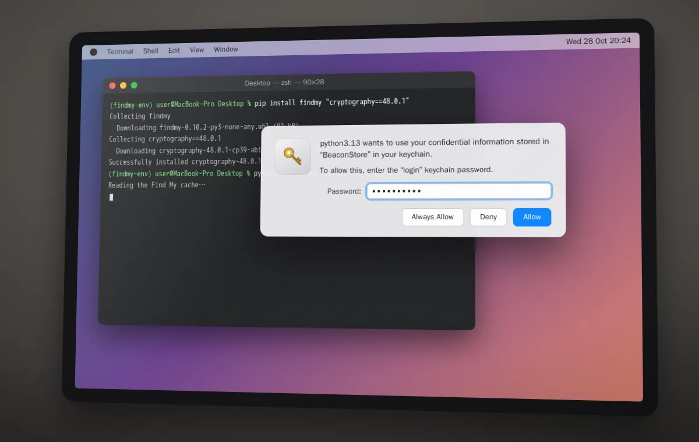
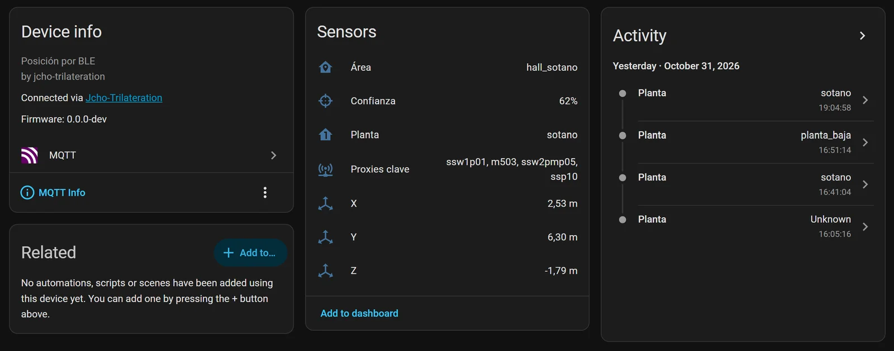
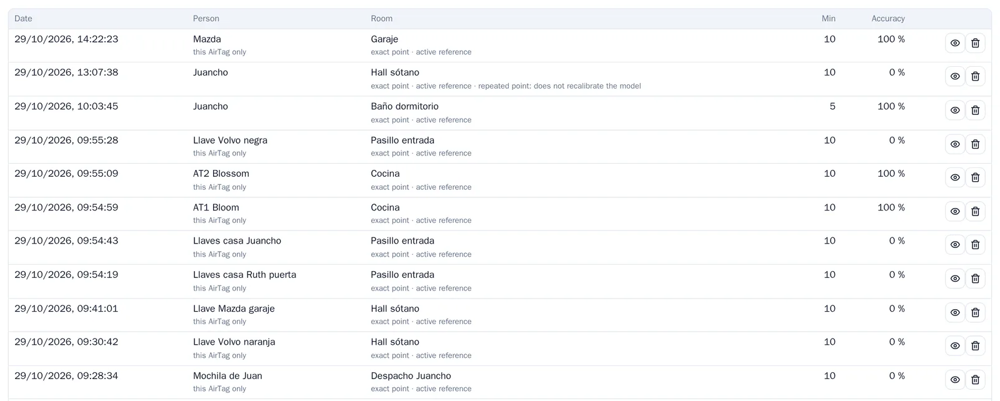
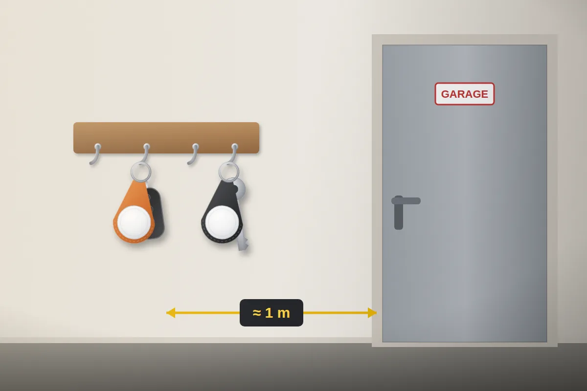
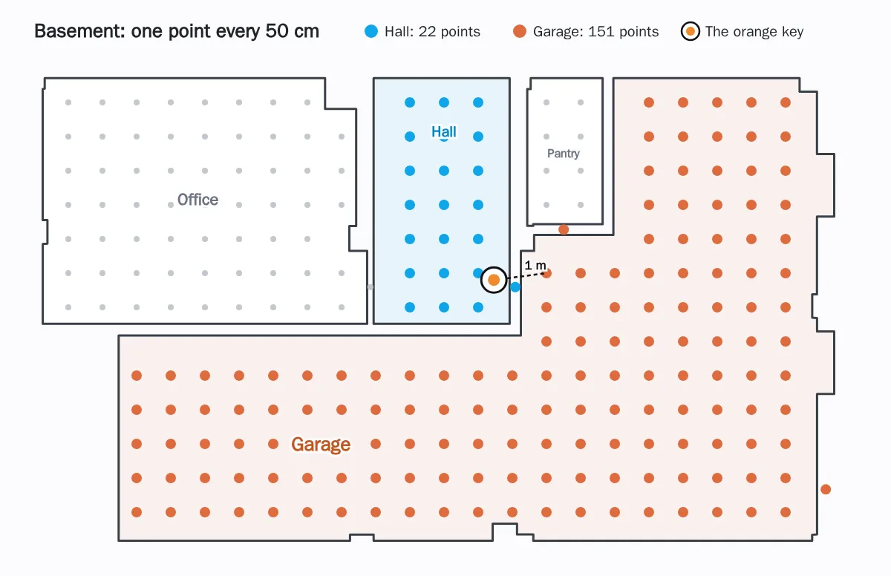
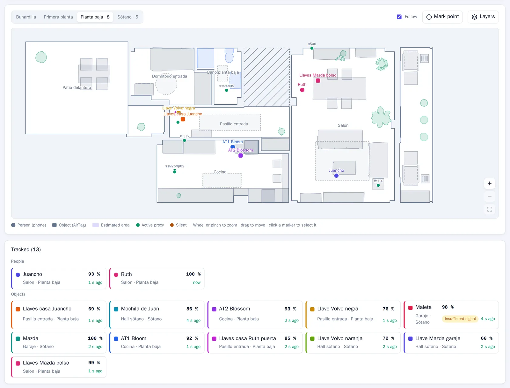
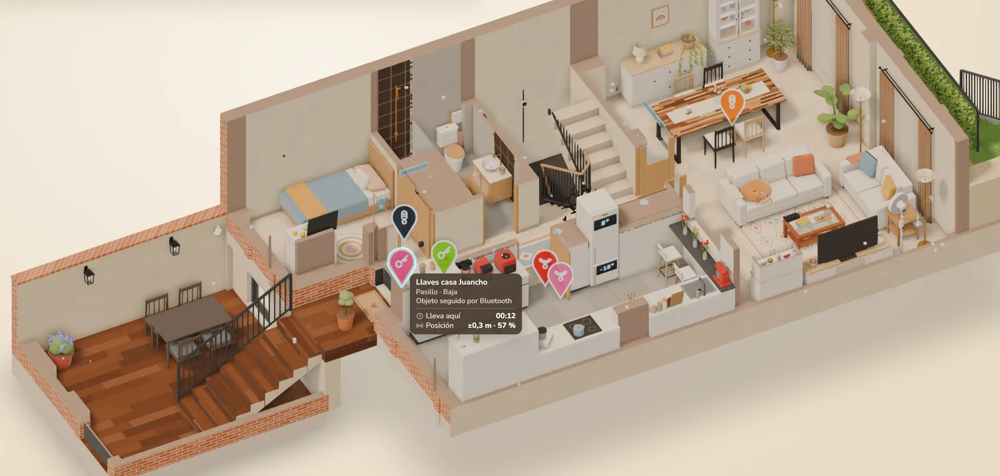

**TL;DR:** Home Assistant ya sabe en qué habitación están mis llaves, la mochila, la maleta y hasta el coche. Son 11 AirTags de Apple, y los localiza por Bluetooth el mismo motor de trilateración que a nosotros, todo en local.

- El [artículo anterior](/blog/bluetooth-trilateration/) acababa con «más cosas que localizar: llaves con una etiqueta Bluetooth…». Ya está hecho.
- Un AirTag no se deja reconocer como un iPhone, y Bermuda no puede con él: cambia de dirección Bluetooth cada cuarto de hora. Pero con sus claves se puede calcular qué dirección usará en cada momento.
- Las claves se sacan una sola vez, con un Mac, y no salen de mi servidor: a Home Assistant solo le llegan las direcciones.
- A partir de ahí, un AirTag es un dispositivo más: plano, histórico, entrenamiento, entidades en Home Assistant y hasta la casa 3D.
- Un AirTag emite mucho menos que un móvil, y eso obligó a cambiar dos cosas: entrenarlos por separado y escucharlos durante más tiempo.
- Todo funciona en local, sin pasar por la nube de Apple ni por la red Buscar (Find My). Lo hice con IA en una tarde y una mañana.

Abro la pestaña Posición de la web del motor y el plano de la planta baja tiene más cuadrados que círculos. Los círculos somos Ruth y yo, en el salón. Los cuadrados son cosas: las llaves de casa, en el pasillo de entrada; las del Mazda, en el bolso, en el salón; dos AirTags más, en la cocina. Si bajo al sótano en el plano, el coche está en el garaje, la maleta también, y la llave naranja del Volvo, en el hall, donde siempre.

## Un AirTag no es un iPhone (y Bermuda no puede con él)

Para seguir nuestros iPhone, Home Assistant usa la integración Private BLE Device. Un iPhone cambia su dirección Bluetooth cada poco para que nadie lo pueda seguir, pero con una clave suya, la IRK, se le reconoce igual. El motor de trilateración se apoya en eso.

Un AirTag no tiene IRK. Cambia de dirección cada 15 minutos mientras está cerca de su dueño, y una vez al día cuando lleva un tiempo lejos. Y esa dirección no es aleatoria: sale de unas claves que solo conocen el AirTag y la cuenta de Apple de su dueño. Así funciona la red Buscar de Apple (Find My): cualquier iPhone que pasa cerca lo oye y manda su posición, cifrada, para que solo la pueda leer su dueño.

Por eso tampoco sirve [Bermuda](https://github.com/agittins/bermuda), la integración de trilateración Bluetooth más popular de Home Assistant: reconoce los móviles por su IRK, las balizas iBeacon y los aparatos que tienen siempre la misma dirección. Un AirTag no es ninguna de las tres.

La app Buscar me dice que las llaves están «en casa». Ya, pero ¿en qué habitación?

Busqué si alguien lo había resuelto ya. Lo más cercano es [hass-FindMy](https://github.com/malmeloo/hass-FindMy), una integración para Home Assistant del autor de FindMy.py: reconoce tus AirTags con sus claves y te dice qué proxy los oye mejor. A mí se me quedaba corto: el proxy que mejor oye algo no siempre está en su habitación. Es lo que me pasaba con Bermuda y los móviles, y por eso hice [mi propio motor de trilateración](/blog/bluetooth-trilateration/).

## Las claves del AirTag: un Mac y FindMy.py

Las claves de un AirTag solo las tienen los aparatos de tu cuenta de Apple. La forma más sencilla de sacarlas es un Mac con tu cuenta y la librería [FindMy.py](https://github.com/malmeloo/FindMy.py), que las descifra de los ficheros de la app Buscar:

```bash
python3.13 -m venv findmy-env
source findmy-env/bin/activate
pip install findmy
python3 -m findmy decrypt --out-dir airtags
```

El Mac pide la contraseña del llavero para una entrada llamada «BeaconStore», que es la que guarda la llave de esos ficheros. Hay que estar delante: por SSH no sale la ventana.

<figure class="cs-pc-sola"><figcaption>El Mac pidiendo la contraseña del llavero para «BeaconStore».</figcaption></figure>

**Ojo con la versión de macOS.** Esto funciona a la primera hasta macOS 14. En macOS 15 a veces también, y si no, hay un método bastante más complicado que obliga a desactivar un rato una protección de seguridad del Mac. En macOS 26, la última, Apple protege mejor la llave de esos ficheros y de momento nadie ha conseguido sacarla, ni siquiera desactivando esa protección: lo explica [la documentación de FindMy.py](https://docs.mikealmel.ooo/FindMy.py/getstarted/02-fetching.html). Así que, si tienes un Mac con macOS 14 o anterior, no lo actualices: es tu llave para dar de alta AirTags nuevos.

El resultado son las claves de todos los aparatos de la cuenta, en JSON: iPhones, Macs, AirPods… y los 11 AirTags. **Esas claves son como una contraseña:** con ellas, cualquiera podría seguir mis AirTags. Viven en el servidor, en una carpeta que no entra en git, y el contenedor del motor las lee en solo lectura.

## Primero, comprobar que los proxies Bluetooth los oyen

Fue lo primero que hicimos, calcular la dirección de cada AirTag en ese momento y buscarla entre lo que oían los proxies. Salió bien: 10 de los 11 se oían, en hasta 20 de los 21 proxies, Shelly incluidos. Cerca de su dueño mandan un mensaje corto, y lejos, uno largo, pero los dos con la dirección que se puede calcular.

## Cómo encaja en el motor de trilateración

La idea es sencilla: si sé qué dirección va a usar cada AirTag, a partir de ahí es igual que un móvil.

<figure class="cs-dg-fig">
<div class="cs-dg">
<div class="cs-ph" style="--c:#dd6b3d">
<div class="cs-phh"><span class="cs-num">1</span><b>Preparar</b><span>una vez por AirTag</span></div>
<div class="cs-row">
<div class="cs-card"><span class="cs-ico"><svg viewBox="0 0 24 24"><rect x="4" y="4.5" width="16" height="11" rx="1.8"/><path d="M2 19.5h20M9.5 17.5h5"/></svg></span><b>El Mac</b><small>Saca las claves de cada AirTag de la app Buscar</small><span class="cs-chips"><span>macOS</span><span>FindMy.py</span></span></div>
<span class="cs-arr"><svg viewBox="0 0 24 24"><path d="M5 12h14M13 6l6 6-6 6"/></svg></span>
<div class="cs-card"><span class="cs-ico"><svg viewBox="0 0 24 24"><circle cx="8" cy="8" r="4.5"/><path d="M11.3 11.3 20.5 20.5M16 16l2.5-2.5M18.3 18.3l2.2-2.2"/></svg></span><b>Las claves</b><small>Un JSON secreto en el servidor, fuera de git y en solo lectura</small><span class="cs-chips"><span>JSON</span></span></div>
<span class="cs-arr"><svg viewBox="0 0 24 24"><path d="M5 12h14M13 6l6 6-6 6"/></svg></span>
<div class="cs-card"><span class="cs-ico"><svg viewBox="0 0 24 24"><circle cx="12" cy="12" r="7.5"/><circle cx="12" cy="12" r="2.5"/><path d="M12 1.5v3M12 19.5v3M1.5 12h3M19.5 12h3"/></svg></span><b>El motor</b><small>Calcula qué direcciones usará cada AirTag en las próximas horas</small><span class="cs-chips"><span>Python</span></span></div>
</div>
</div>
<div class="cs-join" style="--c1:#dd6b3d;--c2:#7465f6"><span>solo las direcciones</span></div>
<div class="cs-ph" style="--c:#7465f6">
<div class="cs-phh"><span class="cs-num">2</span><b>Escuchar y localizar</b><span>sin parar</span></div>
<div class="cs-row">
<div class="cs-card"><span class="cs-ico"><svg viewBox="0 0 24 24"><path d="m7 7 10 10-5 5V2l5 5L7 17"/></svg></span><b>Los 21 proxies</b><small>Oyen a los AirTags igual que a los móviles</small><span class="cs-chips"><span>ESPHome</span><span>Shelly</span></span></div>
<span class="cs-arr"><svg viewBox="0 0 24 24"><path d="M5 12h14M13 6l6 6-6 6"/></svg></span>
<div class="cs-card cs-cerebro"><span class="cs-ico"><svg viewBox="0 0 24 24"><path d="M9 2.5v5M15 2.5v5M6 7.5h12v4a6 6 0 0 1-12 0zM12 17.5v4"/></svg></span><b>La integración</b><small>Reconoce sus direcciones y manda las lecturas con un seudónimo</small><span class="cs-chips"><span>jcho_trilateration</span></span></div>
<span class="cs-arr"><svg viewBox="0 0 24 24"><path d="M5 12h14M13 6l6 6-6 6"/></svg></span>
<div class="cs-card"><span class="cs-ico"><svg viewBox="0 0 24 24"><circle cx="12" cy="12" r="7.5"/><circle cx="12" cy="12" r="2.5"/><path d="M12 1.5v3M12 19.5v3M1.5 12h3M19.5 12h3"/></svg></span><b>El motor</b><small>Lo localiza como a un móvil: área, planta y punto</small><span class="cs-chips"><span>MQTT</span></span></div>
</div>
<div class="cs-out">
<span class="cs-outl"><span>se ve en</span></span>
<div class="cs-card cs-mini"><span class="cs-ico"><svg viewBox="0 0 24 24"><path d="M3 11.2 12 4l9 7.2"/><path d="M5.5 9.5V20h13V9.5"/><circle cx="12" cy="13.2" r="1.7"/><path d="M12 15v2.6M10.4 12.3 8.6 11M13.6 12.3l1.8-1.3"/><circle cx="8" cy="10.6" r=".9"/><circle cx="16" cy="10.6" r=".9"/><circle cx="12" cy="18.3" r=".9"/></svg></span><div><b>Home Assistant</b><small>Un dispositivo por AirTag, con sus entidades</small></div></div>
<div class="cs-card cs-mini"><span class="cs-ico"><svg viewBox="0 0 24 24"><path d="M3.5 20.5h17M6.5 16l4-5 3.5 3 5-7"/></svg></span><div><b>La web del motor</b><small>El plano, el histórico y el entrenamiento</small></div></div>
</div>
</div>
</div>
<figcaption>Arriba, lo que hace falta preparar para los AirTags. Abajo, el mismo camino que siguen los móviles.</figcaption>
</figure>

- El motor lee las claves y calcula las direcciones que puede usar cada AirTag en las próximas horas.
- Se las pasa a mi integración de Home Assistant. Solo las direcciones, que el AirTag ya emite al aire: las claves no salen del motor, igual que la IRK de los iPhone no sale de Home Assistant.
- La integración busca esas direcciones entre todo lo que oyen los proxies y le manda al motor las lecturas con un seudónimo, como hace con los móviles.
- Desde ahí, todo es igual: plano, histórico, entrenamiento y entidades en Home Assistant.

<figure class="cs-pc-sola"><figcaption>Un AirTag en Home Assistant, la llave del Mazda del garaje: llega por MQTT como un dispositivo más, con las mismas entidades que una persona.</figcaption></figure>

El motor recuerda por qué clave va cada AirTag, así que tras un reinicio no tiene que volver a buscarla. Si un AirTag pasa semanas sin oírse, puede perderle la pista; entonces basta con volver a sacar sus claves con el Mac.

Para calcular las direcciones no quise depender de FindMy.py entera: copié y adapté solo la parte que hace falta, que tiene licencia MIT.

<details markdown="1">
<summary>Para los técnicos: cómo sale la dirección</summary>

- **Las claves:** cada AirTag tiene una clave maestra pública y dos secretos, uno para cuando está cerca de su dueño y otro para cuando está lejos. De cada secreto sale una cadena de claves: cada una se deriva de la anterior (KDF ANSI X9.63), y con ella la clave pública de ese momento, en la curva P-224. La dirección Bluetooth son los primeros 6 bytes de esa clave pública.
- **El ritmo:** la clave «cerca» avanza cada 15 minutos; la «lejos», una vez al día.
- **La ventana:** alrededor de la clave que calcula que toca ahora, el motor manda a la integración las direcciones de las 36 horas anteriores y de las 12 siguientes, y las renueva cada minuto. Cada vez que oye un AirTag con una clave concreta, la usa para recolocar la ventana.
- **El protocolo:** el motor primero comprueba que la integración habla su misma versión y solo después le manda las direcciones, con un comando de WebSocket aparte.
- **El estado:** por qué clave va cada AirTag se guarda cada 5 minutos en un fichero, sin claves, solo con una huella para saber a qué AirTag corresponde.

</details>

### Hecho con IA, otra vez

Como el motor, esto lo hice con agentes de IA en [GitHub Copilot](https://github.com/features/copilot), pero esta vez con dos modelos: Claude Opus 5.5 escribe y GPT-6-Astra revisa. Astra revisó el plan antes de empezar y el código, en cuatro rondas.

<div class="cs-cifras">
<div><b>11</b><span>AirTags</span></div>
<div><b>~1 h</b><span>desde el visto bueno hasta verlos en Home Assistant</span></div>
<div><b>4</b><span>rondas de revisión de Astra</span></div>
<div><b>1442</b><span>líneas nuevas en el primer cambio, con sus pruebas</span></div>
</div>

## Entrenar un AirTag sin estropear los móviles

En el [artículo anterior](/blog/bluetooth-trilateration/) conté que al motor se le puede enseñar la casa: te quedas quieto en un punto con el móvil y aprende cómo se oye ese sitio. Mi primera duda fue: si entreno con un AirTag, ¿empeoran los móviles? Pues sí.

Casi todo lo que se aprende es común a todos los dispositivos: cuánto hay que corregir cada proxy, cuánto quitan las paredes y cómo cae la señal con la distancia. Un AirTag emite más flojo y suele estar en un bolso o colgado en la pared. El motor habría tomado esas diferencias como si fueran de los proxies, y eso habría movido a los móviles.

Ahora se aprende en dos niveles:

- **Lo común**, solo con las sesiones de los móviles. Una prueba automática comprueba que lo aprendido para los móviles sale idéntico, haya o no sesiones de AirTags.
- **Lo de cada AirTag:** cuánto emite y cómo se oye en los puntos donde lo entreno. Solo se usa para localizar ese AirTag. Si borro su sesión, vuelve a como estaba.

Además, se pueden entrenar varios a la vez: dejé cada uno en su sitio y lancé 8 sesiones en menos de media hora.

<figure class="cs-pc-sola"><figcaption>Las sesiones de entrenamiento. Las de los AirTags llevan «this AirTag only». Y fíjate en la columna Accuracy: casi todas dicen 0 %.</figcaption></figure>

Ese 0 % no quiere decir que el entrenamiento saliera mal. Es lo que acertó el motor *durante* la sesión: mientras yo tenía la llave quieta en el hall, él la ponía en otro sitio. Eso me llevó al siguiente problema.

## La llave que vivía en el garaje

La llave naranja del Volvo vive en el hall del sótano, a un metro del garaje. La entrené diez minutos en su sitio y el motor seguía en sus trece: garaje.

<figure class="cs-pc-sola"><figcaption>Su sitio: el hall del sótano, a un metro de la puerta del garaje.</figcaption></figure>

El entrenamiento había ido bien: con los datos de esos diez minutos, el punto que mejor encajaba era justo donde estaba la llave. El problema era otro: un AirTag habla muy poco.

<figure class="cs-barras-fig">
<div class="cs-barras">
<div class="cs-b" style="--v:100%;--c:#db2777"><span>iPhone de Ruth</span><i></i><b>329</b></div>
<div class="cs-b" style="--v:81%;--c:#4f46e5"><span>Mi iPhone</span><i></i><b>266</b></div>
<div class="cs-b" style="--v:31%;--c:#0ea5e9"><span>El AirTag que más se oye</span><i></i><b>102</b></div>
<div class="cs-b" style="--v:24.6%;--c:#0ea5e9"><span>Un AirTag normal</span><i></i><b>81</b></div>
<div class="cs-b" style="--v:8.1%;--c:#dd6b3d"><span>La mochila</span><i></i><b>27</b></div>
</div>
<figcaption>Lecturas por minuto, sumando todos los proxies, durante una hora. «Un AirTag normal» es la mediana de los 11.</figcaption>
</figure>

El motor decide con lo que han oído los proxies en los últimos 3 segundos. Con un móvil, eso son más de diez lecturas. Con un AirTag, unas pocas, de unos tres proxies, con una o dos lecturas cada uno: pistas pobres que cambian a cada momento.

Y con pistas pobres, gana la zona grande. El motor reparte la probabilidad entre puntos separados 50 cm, y el área con más puntos se lleva más probabilidad. El garaje tiene 151; el hall, 22.

<figure class="cs-pc-sola"><figcaption>El sótano como lo ve el motor: un punto cada 50 cm. La llave está a un metro del garaje, que tiene casi siete veces más puntos que el hall.</figcaption></figure>

Para probarlo, repetí la sesión de entrenamiento con los datos grabados, pero mirando los últimos 15 segundos en vez de 3:

<div class="cs-cifras cs-dos">
<div><b>0 %</b><span>del tiempo en el hall, mirando 3 segundos</span></div>
<div><b>96 %</b><span>mirando 15 segundos</span></div>
</div>

Así que ahora, solo para los AirTags, el motor mira 15 segundos. Los móviles siguen igual. La pega: si cojo las llaves y me las llevo, tarda unos segundos más en darse cuenta.

En las primeras 27 horas tras el cambio, la llave naranja ha estado en el hall el 91 % del tiempo.

## Una web para muchos dispositivos

La pestaña Posición estaba pensada para dos personas. Con once cosas más, los nombres se cortaban y el plano se quedaba pequeño. Ahora:

- El plano ocupa casi toda la pantalla, se amplía con la rueda o con dos dedos y se mueve arrastrando. En pantallas anchas se gira para aprovechar el ancho.
- Las personas son círculos, y las cosas, cuadrados.
- Debajo hay una ficha para cada uno, separadas en personas y objetos. Al tocar una, el plano va hasta él y enseña su detalle.

<figure class="cs-pc-sola"><figcaption>La planta baja: Ruth y yo en el salón, las llaves de casa en el pasillo de entrada, las del Mazda en el bolso y dos AirTags más en la cocina. Debajo, una ficha por cada uno.</figcaption></figure>

### También en la casa 3D

La [casa 3D](/blog/home-assistant-3d-house/) también los dibuja. Cada AirTag es una chincheta con su icono en la habitación donde está, con sus líneas a los proxies clave. Al pasar por encima, un globo dice dónde está, desde cuándo y con qué confianza.

<figure class="cs-pc-sola"><figcaption>La planta baja de la casa 3D, con los AirTags como chinchetas. Las llaves de casa, seleccionadas, en el pasillo.</figcaption></figure>

## Preguntas

### ¿Gasta la batería del AirTag?

No. Los proxies solo escuchan lo que el AirTag ya emite para la red Buscar.

### ¿Sigue funcionando Buscar (Find My)?

Sí. No toco nada del AirTag ni de la cuenta de Apple: solo escucho.

### ¿Funciona en local, sin internet?

Sí. Los proxies, Home Assistant y el motor funcionan en casa, sin la nube de Apple. El Mac solo hace falta una vez, para sacar las claves.

### ¿Hace falta un Mac?

Sí, uno con macOS 14 o anterior, para sacar las claves una vez, y otra si vuelves a emparejar el AirTag. Con macOS 26 ya no se puede.

### ¿Funciona con otras etiquetas de la red Buscar?

En teoría, sí: todos los accesorios de la red Buscar usan el mismo sistema. Yo solo lo he probado con AirTags.

### ¿Es seguro?

Las claves solo están en el servidor, fuera de git, y el motor las lee en solo lectura. No salen en los registros ni en la web. Home Assistant solo recibe las direcciones de las próximas horas, que el AirTag ya emite al aire.

### ¿Dónde está el código?

Como el motor, de momento no es público.

<style>
.body details { border: 1px solid var(--border); border-radius: 16px; background: var(--tile2); padding: 0 20px; }
.body details[open] { padding-bottom: 18px; }
.body details > * + * { margin-top: 1em; }
.body summary { cursor: pointer; list-style: none; display: flex; align-items: center; gap: 12px; padding: 15px 0; font-weight: 700; color: var(--fg); }
.body summary::-webkit-details-marker { display: none; }
.body summary::before { content: ''; flex: none; width: 8px; height: 8px; border-right: 2.5px solid var(--a1); border-bottom: 2.5px solid var(--a1); transform: rotate(-45deg); transition: transform .2s; margin-left: 2px; }
.body details[open] > summary::before { transform: rotate(45deg); }

.body .cs-pc-sola img { border-radius: 12px; background: transparent; border: 1px solid var(--border); box-shadow: var(--shadow); }

.cs-cifras { display: grid; grid-template-columns: repeat(4, 1fr); gap: 12px; }
.cs-cifras > div { background: var(--tile2); border: 1px solid var(--border); border-radius: 16px; padding: 16px 10px 14px; text-align: center; }
.cs-cifras b { display: block; font-size: 34px; line-height: 1.1; font-weight: 800; letter-spacing: -.03em; background: var(--grad); -webkit-background-clip: text; background-clip: text; color: transparent; }
.cs-cifras span { display: block; margin-top: 4px; font-size: 13px; line-height: 1.3; color: var(--mute); }
.cs-cifras.cs-dos { grid-template-columns: repeat(2, 1fr); max-width: 520px; margin: 1.6em auto; }

.body .cs-barras-fig { margin: 2em 0; }
.cs-barras { display: grid; gap: 12px; padding: 20px 22px; border-radius: 22px; border: 1px solid var(--border); background: radial-gradient(90% 70% at 0% 0%, color-mix(in srgb, #db2777 8%, transparent), transparent 70%), radial-gradient(90% 70% at 100% 100%, color-mix(in srgb, #0ea5e9 11%, transparent), transparent 70%), var(--tile2); }
.cs-b { display: grid; grid-template-columns: 190px 1fr 44px; align-items: center; gap: 12px; }
.cs-b span { color: var(--fg); font-size: 14px; font-weight: 650; line-height: 1.25; }
.cs-b i { display: block; width: var(--v); height: 14px; border-radius: 99px; background: linear-gradient(90deg, var(--c), color-mix(in srgb, var(--c) 55%, #fff)); box-shadow: 0 4px 10px -4px var(--c); }
.cs-b b { font: 700 13px var(--mono); color: var(--fg); text-align: right; }

.body .cs-dg-fig { margin: 2em 0; }
.cs-dg { padding: 20px; border-radius: 22px; border: 1px solid var(--border); background: radial-gradient(90% 60% at 0% 0%, color-mix(in srgb, #dd6b3d 10%, transparent), transparent 70%), radial-gradient(90% 60% at 100% 100%, color-mix(in srgb, #7465f6 11%, transparent), transparent 70%), var(--tile2); }
.cs-ph { position: relative; padding: 14px; border-radius: 18px; background: color-mix(in srgb, var(--c) 5%, var(--tile)); border: 1px solid color-mix(in srgb, var(--c) 24%, transparent); }
.cs-phh { display: flex; align-items: center; gap: 10px; flex-wrap: wrap; margin: 0 0 12px 2px; font-size: 12.5px; color: var(--mute); }
.cs-phh b { color: var(--fg); font-size: 15px; font-weight: 800; letter-spacing: -.01em; }
.cs-phh span:last-child { padding-left: 10px; border-left: 1px solid var(--border); }
.cs-num { width: 24px; height: 24px; display: grid; place-items: center; border-radius: 8px; background: var(--c); color: #fff; font: 700 12.5px var(--mono); box-shadow: 0 4px 10px -3px var(--c); }
.cs-row { display: grid; grid-template-columns: 1fr 26px 1fr 26px 1fr; }
.cs-card { display: flex; flex-direction: column; gap: 3px; padding: 12px 12px 11px; border-radius: 14px; background: var(--tile); border: 1px solid var(--border); box-shadow: 0 1px 2px rgba(15, 18, 34, .04), 0 8px 18px -10px color-mix(in srgb, var(--c) 45%, transparent); }
.cs-card b { color: var(--fg); font-size: 14px; line-height: 1.25; font-weight: 750; }
.cs-card small { color: var(--mute); font-size: 12.5px; line-height: 1.4; }
.cs-ico { width: 34px; height: 34px; display: grid; place-items: center; flex: none; margin-bottom: 5px; border-radius: 10px; color: var(--c); background: color-mix(in srgb, var(--c) 14%, transparent); }
.cs-ico svg, .cs-arr svg { width: 19px; height: 19px; fill: none; stroke: currentColor; stroke-width: 1.8; stroke-linecap: round; stroke-linejoin: round; }
.cs-chips { display: flex; flex-wrap: wrap; gap: 4px; margin-top: auto; padding-top: 7px; }
.cs-chips span { font: 600 10.5px var(--mono); letter-spacing: .02em; color: var(--c); background: color-mix(in srgb, var(--c) 11%, transparent); padding: 2px 7px; border-radius: 6px; }
.cs-arr { display: grid; place-items: center; color: var(--c); }
.cs-arr svg { width: 18px; height: 18px; stroke-width: 2.2; }
.cs-cerebro { border: 1.5px solid transparent; background: linear-gradient(var(--tile), var(--tile)) padding-box, linear-gradient(135deg, #0ea5e9, #7465f6) border-box; }
.cs-join { position: relative; display: flex; justify-content: center; align-items: center; height: 46px; }
.cs-join::before { content: ''; position: absolute; top: 0; bottom: 6px; left: 50%; width: 2px; transform: translateX(-50%); background: linear-gradient(var(--c1), var(--c2)); }
.cs-join::after { content: ''; position: absolute; bottom: 0; left: 50%; transform: translateX(-50%); border: 6px solid transparent; border-top: 7px solid var(--c2); border-bottom: 0; }
.cs-join span { position: relative; font: 600 10.5px var(--mono); letter-spacing: .1em; text-transform: uppercase; color: var(--mute); background: var(--tile); border: 1px solid var(--border); padding: 3px 10px; border-radius: 99px; }
.cs-out { display: grid; grid-template-columns: 1fr 1fr; gap: 10px; margin-top: 14px; }
.cs-outl { grid-column: 1 / -1; display: flex; align-items: center; gap: 10px; }
.cs-outl::before, .cs-outl::after { content: ''; flex: 1; border-top: 1px dashed color-mix(in srgb, var(--c) 40%, transparent); }
.cs-outl span { font: 600 10.5px var(--mono); letter-spacing: .1em; text-transform: uppercase; color: var(--mute); background: var(--tile); border: 1px solid var(--border); padding: 3px 10px; border-radius: 99px; }
.cs-card.cs-mini { flex-direction: row; align-items: center; gap: 10px; padding: 10px 12px; }
.cs-mini .cs-ico { margin: 0; }
.cs-mini b, .cs-mini small { display: block; }

@media (max-width: 680px) {
  .cs-dg { padding: 12px; }
  .cs-ph { padding: 12px; }
  .cs-row { grid-template-columns: 1fr; }
  .cs-arr { height: 26px; }
  .cs-arr svg { transform: rotate(90deg); }
  .cs-phh span:last-child { flex-basis: 100%; padding-left: 34px; border-left: 0; margin-top: -6px; }
  .cs-out { grid-template-columns: 1fr; }
  .cs-cifras { grid-template-columns: repeat(2, 1fr); }
  .cs-barras { padding: 16px 14px; }
  .cs-b { grid-template-columns: 1fr 40px; gap: 4px 10px; }
  .cs-b span { grid-column: 1 / -1; }
}
</style>
