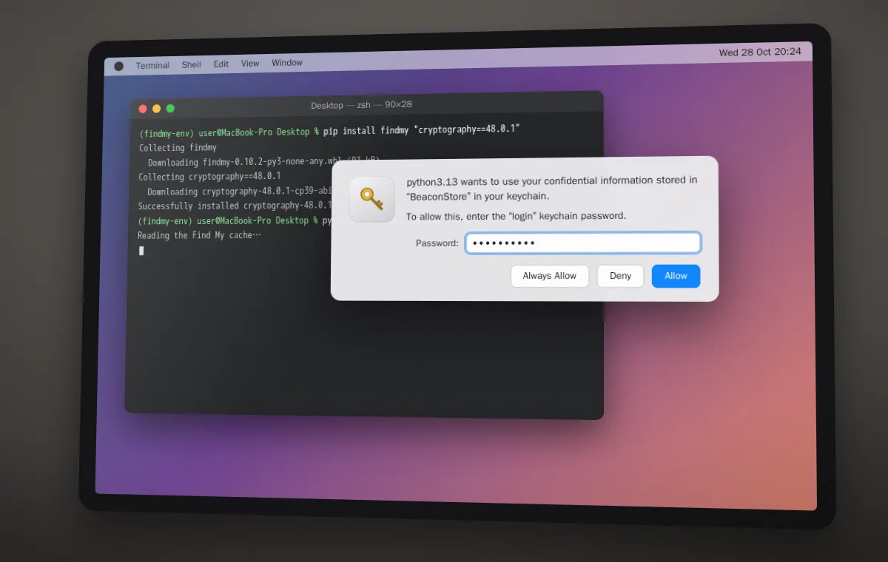
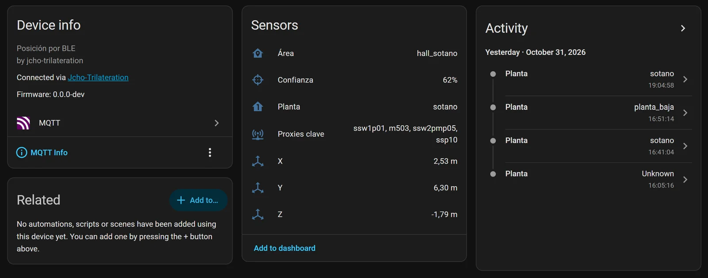
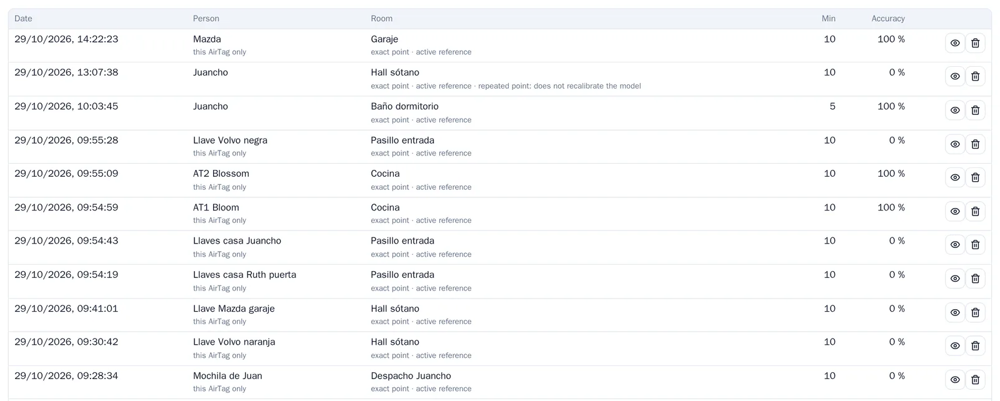
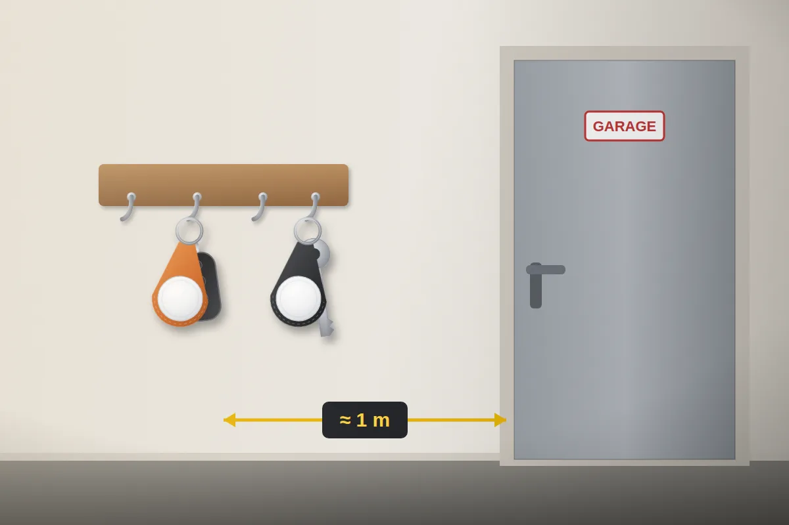
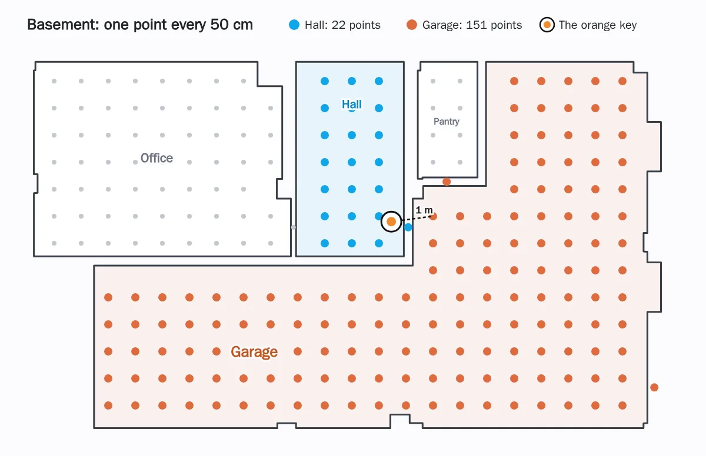
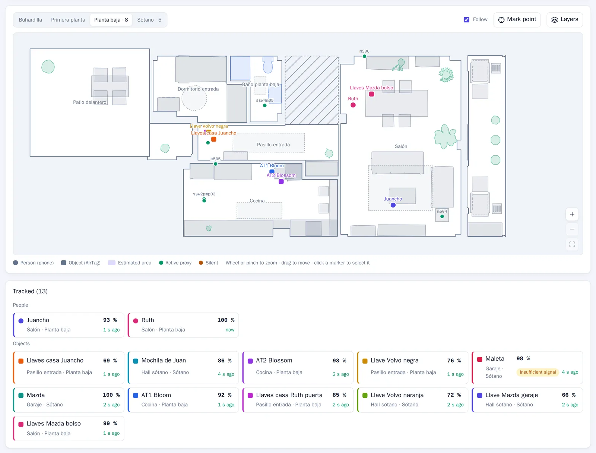
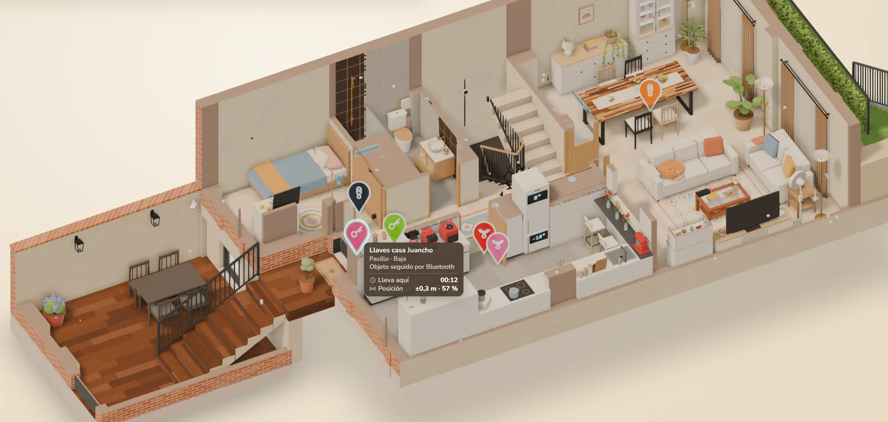

**TL;DR:** Home Assistant now knows which room my keys, the backpack, the suitcase and even the car are in. They're 11 Apple AirTags, and the same Bluetooth trilateration engine that locates us locates them too, all of it locally.

- The [previous post](/blog/bluetooth-trilateration/) ended with "more things to locate: watches, keys with a Bluetooth tag…". Done.
- An AirTag can't be recognized the way an iPhone can, and Bermuda can't handle it: it changes its Bluetooth address every quarter of an hour. But with its keys you can work out which address it will use at any moment.
- The keys are pulled out once, with a Mac, and never leave my server: Home Assistant only gets the addresses.
- From there on, an AirTag is just another device: floor plan, history, training, Home Assistant entities and even the 3D house.
- An AirTag broadcasts far less than a phone, and that forced two changes: training them separately and listening to them for longer.
- Everything runs locally, without going through Apple's cloud or the Find My network. I built it with AI in an afternoon and a morning.

I open the Position tab of the engine's web app, and the ground floor plan has more squares than circles. The circles are Ruth and me, in the living room. The squares are things: the house keys, in the entrance hallway; the Mazda keys, in the handbag, in the living room; two more AirTags, in the kitchen. If I switch the plan to the basement, the car is in the garage, so is the suitcase, and the orange Volvo key is in the hall, where it always is.

## An AirTag isn't an iPhone (and Bermuda can't handle it)

To follow our iPhones, Home Assistant uses the Private BLE Device integration. An iPhone changes its Bluetooth address every so often so nobody can follow it, but with one of its keys, the IRK, you can still recognize it. The trilateration engine relies on that.

An AirTag has no IRK. It changes its address every 15 minutes while it's near its owner, and once a day when it has been away for a while. And that address isn't random: it comes from keys that only the AirTag and its owner's Apple account know. That's how Apple's Find My network works: any iPhone passing by hears it and sends its location, encrypted, so only its owner can read it.

That's also why [Bermuda](https://github.com/agittins/bermuda), the most popular Bluetooth trilateration integration for Home Assistant, is no use here: it recognizes phones by their IRK, iBeacons and devices that always keep the same address. An AirTag is none of the three.

The Find My app tells me the keys are "at home". Sure, but in which room?

I looked for anyone who had already solved it. The closest is [hass-FindMy](https://github.com/malmeloo/hass-FindMy), a Home Assistant integration by the author of FindMy.py: it recognizes your AirTags with their keys and tells you which proxy hears them best. That fell short for me: the proxy that hears something best isn't always in the same room. That's what happened to me with Bermuda and the phones, and why I built [my own trilateration engine](/blog/bluetooth-trilateration/).

## The AirTag keys: a Mac and FindMy.py

An AirTag's keys are only held by the devices on your Apple account. The easiest way to get them is a Mac signed into your account and the [FindMy.py](https://github.com/malmeloo/FindMy.py) library, which decrypts them from the Find My app's files:

```bash
python3.13 -m venv findmy-env
source findmy-env/bin/activate
pip install findmy
python3 -m findmy decrypt --out-dir airtags
```

The Mac asks for the keychain password for an entry called "BeaconStore", which holds the key to those files. You have to be sitting in front of it: over SSH, the prompt never shows up.

<figure class="cs-pc-sola"><figcaption>The Mac asking for the keychain password for "BeaconStore".</figcaption></figure>

**Watch your macOS version.** This works first time up to macOS 14. On macOS 15 it sometimes does too, and if not, there's a much more complicated method that requires temporarily disabling one of the Mac's security protections. On macOS 26, the latest, Apple protects the key to those files better, and so far nobody has managed to get it out, not even with that protection disabled: [FindMy.py's documentation](https://docs.mikealmel.ooo/FindMy.py/getstarted/02-fetching.html) explains it. So if you have a Mac on macOS 14 or earlier, don't update it: it's your key to adding new AirTags.

The result is the keys of every device on the account, as JSON: iPhones, Macs, AirPods… and the 11 AirTags. **Those keys are like a password:** with them, anyone could track my AirTags. They live on the server, in a folder that stays out of git, and the engine's container can only read them.

## First, check that the Bluetooth proxies hear them

That was the first thing we did: work out each AirTag's address at that moment and look for it among what the proxies were hearing. It worked: 10 of the 11 could be heard, by up to 20 of the 21 proxies, Shellys included. Near their owner they send a short message, and away from it a long one, but both carry the address you can work out.

## How it fits into the trilateration engine

The idea is simple: if I know which address each AirTag is going to use, from there on it's just like a phone.

<figure class="cs-dg-fig">
<div class="cs-dg">
<div class="cs-ph" style="--c:#dd6b3d">
<div class="cs-phh"><span class="cs-num">1</span><b>Preparing</b><span>once per AirTag</span></div>
<div class="cs-row">
<div class="cs-card"><span class="cs-ico"><svg viewBox="0 0 24 24"><rect x="4" y="4.5" width="16" height="11" rx="1.8"/><path d="M2 19.5h20M9.5 17.5h5"/></svg></span><b>The Mac</b><small>Pulls each AirTag's keys out of the Find My app</small><span class="cs-chips"><span>macOS</span><span>FindMy.py</span></span></div>
<span class="cs-arr"><svg viewBox="0 0 24 24"><path d="M5 12h14M13 6l6 6-6 6"/></svg></span>
<div class="cs-card"><span class="cs-ico"><svg viewBox="0 0 24 24"><circle cx="8" cy="8" r="4.5"/><path d="M11.3 11.3 20.5 20.5M16 16l2.5-2.5M18.3 18.3l2.2-2.2"/></svg></span><b>The keys</b><small>A secret JSON on the server, out of git and read-only</small><span class="cs-chips"><span>JSON</span></span></div>
<span class="cs-arr"><svg viewBox="0 0 24 24"><path d="M5 12h14M13 6l6 6-6 6"/></svg></span>
<div class="cs-card"><span class="cs-ico"><svg viewBox="0 0 24 24"><circle cx="12" cy="12" r="7.5"/><circle cx="12" cy="12" r="2.5"/><path d="M12 1.5v3M12 19.5v3M1.5 12h3M19.5 12h3"/></svg></span><b>The engine</b><small>Works out which addresses each AirTag will use in the coming hours</small><span class="cs-chips"><span>Python</span></span></div>
</div>
</div>
<div class="cs-join" style="--c1:#dd6b3d;--c2:#7465f6"><span>only the addresses</span></div>
<div class="cs-ph" style="--c:#7465f6">
<div class="cs-phh"><span class="cs-num">2</span><b>Listening and locating</b><span>nonstop</span></div>
<div class="cs-row">
<div class="cs-card"><span class="cs-ico"><svg viewBox="0 0 24 24"><path d="m7 7 10 10-5 5V2l5 5L7 17"/></svg></span><b>The 21 proxies</b><small>Hear the AirTags just like they hear the phones</small><span class="cs-chips"><span>ESPHome</span><span>Shelly</span></span></div>
<span class="cs-arr"><svg viewBox="0 0 24 24"><path d="M5 12h14M13 6l6 6-6 6"/></svg></span>
<div class="cs-card cs-cerebro"><span class="cs-ico"><svg viewBox="0 0 24 24"><path d="M9 2.5v5M15 2.5v5M6 7.5h12v4a6 6 0 0 1-12 0zM12 17.5v4"/></svg></span><b>The integration</b><small>Spots their addresses and passes the readings on under a pseudonym</small><span class="cs-chips"><span>jcho_trilateration</span></span></div>
<span class="cs-arr"><svg viewBox="0 0 24 24"><path d="M5 12h14M13 6l6 6-6 6"/></svg></span>
<div class="cs-card"><span class="cs-ico"><svg viewBox="0 0 24 24"><circle cx="12" cy="12" r="7.5"/><circle cx="12" cy="12" r="2.5"/><path d="M12 1.5v3M12 19.5v3M1.5 12h3M19.5 12h3"/></svg></span><b>The engine</b><small>Locates it like a phone: area, floor and spot</small><span class="cs-chips"><span>MQTT</span></span></div>
</div>
<div class="cs-out">
<span class="cs-outl"><span>shown in</span></span>
<div class="cs-card cs-mini"><span class="cs-ico"><svg viewBox="0 0 24 24"><path d="M3 11.2 12 4l9 7.2"/><path d="M5.5 9.5V20h13V9.5"/><circle cx="12" cy="13.2" r="1.7"/><path d="M12 15v2.6M10.4 12.3 8.6 11M13.6 12.3l1.8-1.3"/><circle cx="8" cy="10.6" r=".9"/><circle cx="16" cy="10.6" r=".9"/><circle cx="12" cy="18.3" r=".9"/></svg></span><div><b>Home Assistant</b><small>One device per AirTag, with its entities</small></div></div>
<div class="cs-card cs-mini"><span class="cs-ico"><svg viewBox="0 0 24 24"><path d="M3.5 20.5h17M6.5 16l4-5 3.5 3 5-7"/></svg></span><div><b>The engine's web app</b><small>The floor plan, history and training</small></div></div>
</div>
</div>
</div>
<figcaption>At the top, what the AirTags need. At the bottom, the same path the phones follow.</figcaption>
</figure>

- The engine reads the keys and works out the addresses each AirTag may use in the coming hours.
- It passes them to my Home Assistant integration. Only the addresses, which the AirTag already broadcasts over the air: the keys never leave the engine, just as the iPhones' IRK never leaves Home Assistant.
- The integration looks for those addresses among everything the proxies hear and sends the readings to the engine under a pseudonym, as it does with the phones.
- From there, everything is the same: floor plan, history, training and Home Assistant entities.

<figure class="cs-pc-sola"><figcaption>An AirTag in Home Assistant, the garage Mazda key: it arrives over MQTT as just another device, with the same entities as a person. My Home Assistant speaks Spanish: Área is the area, Confianza the confidence, Planta the floor and Proxies clave the key proxies.</figcaption></figure>

The engine remembers which key each AirTag is on, so after a restart it doesn't have to look for it again. If an AirTag goes unheard for weeks, the engine may lose track of it; then you just pull its keys out with the Mac again.

To work out the addresses I didn't want to depend on the whole of FindMy.py: I copied and adapted just the part I needed, which is MIT-licensed.

<details markdown="1">
<summary>For the techies: how the address is derived</summary>

- **The keys:** each AirTag has a public master key and two secrets, one for when it's near its owner and another for when it's away. Each secret yields a chain of keys, each one derived from the previous one (ANSI X9.63 KDF), and from it that moment's public key, on the P-224 curve. The Bluetooth address is the first 6 bytes of that public key.
- **The pace:** the "near" key moves on every 15 minutes; the "away" one, once a day.
- **The window:** around the key it reckons is current, the engine sends the integration the addresses for the previous 36 hours and the next 12, and refreshes them every minute. Every time it hears an AirTag with a specific key, it uses that key to re-center the window.
- **The protocol:** the engine first checks that the integration speaks its version and only then sends it the addresses, with a separate WebSocket command.
- **The state:** which key each AirTag is on is saved every 5 minutes to a file, with no keys, just a fingerprint to know which AirTag it belongs to.

</details>

### Built with AI, again

Like the engine, I built this with AI agents in [GitHub Copilot](https://github.com/features/copilot), but this time with two models: Claude Opus 5.5 writes and GPT-6-Astra reviews. Astra reviewed the plan before I started and then the code, over four rounds.

<div class="cs-cifras">
<div><b>11</b><span>AirTags</span></div>
<div><b>~1 h</b><span>from my go-ahead to seeing them in Home Assistant</span></div>
<div><b>4</b><span>rounds of review by Astra</span></div>
<div><b>1442</b><span>new lines in the first change, tests included</span></div>
</div>

## Training an AirTag without spoiling the phones

In the [previous post](/blog/bluetooth-trilateration/) I explained that you can teach the engine the house: you stand still at a spot with your phone and it learns what that spot sounds like. My first question was: if I train with an AirTag, do the phones get worse? They do.

Almost everything it learns is shared by all devices: how much to correct each proxy, how much the walls take away and how the signal drops with distance. An AirTag broadcasts more weakly and usually sits in a bag or hangs on a wall. The engine would have taken those differences as if they came from the proxies, and that would have moved the phones.

Now learning happens on two levels:

- **What's shared**, learned only from the phones' sessions. An automated test checks that what's learned for the phones comes out identical, with or without AirTag sessions.
- **What's specific to each AirTag:** how strongly it broadcasts and what it sounds like at the spots where I train it. It's only used to locate that AirTag. If I delete its session, it goes back to how it was.

And you can train several at once: I left each one in its place and started 8 sessions in under half an hour.

<figure class="cs-pc-sola"><figcaption>The training sessions. The AirTag ones say "this AirTag only". And look at the Accuracy column: almost all of them say 0%.</figcaption></figure>

That 0% doesn't mean the training went wrong. It's how often the engine got it right *during* the session: while the key sat still in the hall, the engine kept putting it somewhere else. That led me to the next problem.

## The key that lived in the garage

The orange Volvo key lives in the basement hall, a meter from the garage. I trained it for ten minutes in its spot and the engine wouldn't budge: garage.

<figure class="cs-pc-sola"><figcaption>Its spot: the basement hall, a meter from the garage door.</figcaption></figure>

The training had gone fine: with the data from those ten minutes, the point that fit best was exactly where the key was. The problem was something else: an AirTag barely talks.

<figure class="cs-barras-fig">
<div class="cs-barras">
<div class="cs-b" style="--v:100%;--c:#db2777"><span>Ruth's iPhone</span><i></i><b>329</b></div>
<div class="cs-b" style="--v:81%;--c:#4f46e5"><span>My iPhone</span><i></i><b>266</b></div>
<div class="cs-b" style="--v:31%;--c:#0ea5e9"><span>The loudest AirTag</span><i></i><b>102</b></div>
<div class="cs-b" style="--v:24.6%;--c:#0ea5e9"><span>A typical AirTag</span><i></i><b>81</b></div>
<div class="cs-b" style="--v:8.1%;--c:#dd6b3d"><span>The backpack</span><i></i><b>27</b></div>
</div>
<figcaption>Readings per minute, adding up all the proxies, over one hour. "A typical AirTag" is the median of the 11.</figcaption>
</figure>

The engine decides based on what the proxies heard in the last 3 seconds. With a phone, that's more than ten readings. With an AirTag, just a few, from about three proxies, with one or two readings each: thin clues that change all the time.

And with thin clues, the big area wins. The engine spreads the probability over points 50 cm apart, and the area with more points gets more probability. The garage has 151; the hall, 22.

<figure class="cs-pc-sola"><figcaption>The basement as the engine sees it: one point every 50 cm. The key is a meter from the garage, which has almost seven times as many points as the hall.</figcaption></figure>

To test it, I replayed the training session with the recorded data, but looking at the last 15 seconds instead of 3:

<div class="cs-cifras cs-dos">
<div><b>0%</b><span>of the time in the hall, looking at 3 seconds</span></div>
<div><b>96%</b><span>looking at 15 seconds</span></div>
</div>

So now, for AirTags only, the engine looks at 15 seconds. The phones stay the same. The downside: if I grab the keys and take them away, it takes a few more seconds to notice.

In the first 27 hours after the change, the orange key was in the hall 91% of the time.

## A web app for many devices

The Position tab was designed for two people. With eleven more things, names got cut off and the floor plan was too small. Now:

- The floor plan takes up almost the whole screen, zooms with the wheel or two fingers and pans by dragging. On wide screens it rotates to make the most of the width.
- People are circles, and things, squares.
- Below it there's a card for each one, split into people and objects. Tap one and the plan moves to it and shows its details.

<figure class="cs-pc-sola"><figcaption>The ground floor: Ruth and me in the living room, the house keys in the entrance hallway, the Mazda keys in the handbag and two more AirTags in the kitchen. Below, a card for each one.</figcaption></figure>

### In the 3D house too

The [3D house](/blog/home-assistant-3d-house/) draws them too. Each AirTag is a pin with its own icon in the room where it is, with its lines to the key proxies. Hover over one and a tooltip tells you where it is, since when, and how confident the engine is.

<figure class="cs-pc-sola"><figcaption>The ground floor of the 3D house, with the AirTags as pins. The house keys, selected, in the hallway.</figcaption></figure>

## Q&A

### Does it drain the AirTag's battery?

No. The proxies only listen to what the AirTag already broadcasts for the Find My network.

### Does Find My still work?

Yes. I don't touch anything on the AirTag or the Apple account: I only listen.

### Does it work locally, without internet?

Yes. The proxies, Home Assistant and the engine all run at home, without Apple's cloud. You only need the Mac once, to get the keys out.

### Do I need a Mac?

Yes, one on macOS 14 or earlier, to get the keys out once, and again if you re-pair the AirTag. On macOS 26 it's no longer possible.

### Does it work with other Find My tags?

In theory, yes: all Find My network accessories use the same system. I've only tested it with AirTags.

### Is it safe?

The keys only live on the server, out of git, and the engine can only read them. They never show up in the logs or the web app. Home Assistant only gets the addresses for the coming hours, which the AirTag already broadcasts over the air.

### Where's the code?

Like the engine, it's not public for now.

<style>
.body details { border: 1px solid var(--border); border-radius: 16px; background: var(--tile2); padding: 0 20px; }
.body details[open] { padding-bottom: 18px; }
.body details > * + * { margin-top: 1em; }
.body summary { cursor: pointer; list-style: none; display: flex; align-items: center; gap: 12px; padding: 15px 0; font-weight: 700; color: var(--fg); }
.body summary::-webkit-details-marker { display: none; }
.body summary::before { content: ''; flex: none; width: 8px; height: 8px; border-right: 2.5px solid var(--a1); border-bottom: 2.5px solid var(--a1); transform: rotate(-45deg); transition: transform .2s; margin-left: 2px; }
.body details[open] > summary::before { transform: rotate(45deg); }

.body .cs-pc-sola img { border-radius: 12px; background: transparent; border: 1px solid var(--border); box-shadow: var(--shadow); }

.cs-cifras { display: grid; grid-template-columns: repeat(4, 1fr); gap: 12px; }
.cs-cifras > div { background: var(--tile2); border: 1px solid var(--border); border-radius: 16px; padding: 16px 10px 14px; text-align: center; }
.cs-cifras b { display: block; font-size: 34px; line-height: 1.1; font-weight: 800; letter-spacing: -.03em; background: var(--grad); -webkit-background-clip: text; background-clip: text; color: transparent; }
.cs-cifras span { display: block; margin-top: 4px; font-size: 13px; line-height: 1.3; color: var(--mute); }
.cs-cifras.cs-dos { grid-template-columns: repeat(2, 1fr); max-width: 520px; margin: 1.6em auto; }

.body .cs-barras-fig { margin: 2em 0; }
.cs-barras { display: grid; gap: 12px; padding: 20px 22px; border-radius: 22px; border: 1px solid var(--border); background: radial-gradient(90% 70% at 0% 0%, color-mix(in srgb, #db2777 8%, transparent), transparent 70%), radial-gradient(90% 70% at 100% 100%, color-mix(in srgb, #0ea5e9 11%, transparent), transparent 70%), var(--tile2); }
.cs-b { display: grid; grid-template-columns: 190px 1fr 44px; align-items: center; gap: 12px; }
.cs-b span { color: var(--fg); font-size: 14px; font-weight: 650; line-height: 1.25; }
.cs-b i { display: block; width: var(--v); height: 14px; border-radius: 99px; background: linear-gradient(90deg, var(--c), color-mix(in srgb, var(--c) 55%, #fff)); box-shadow: 0 4px 10px -4px var(--c); }
.cs-b b { font: 700 13px var(--mono); color: var(--fg); text-align: right; }

.body .cs-dg-fig { margin: 2em 0; }
.cs-dg { padding: 20px; border-radius: 22px; border: 1px solid var(--border); background: radial-gradient(90% 60% at 0% 0%, color-mix(in srgb, #dd6b3d 10%, transparent), transparent 70%), radial-gradient(90% 60% at 100% 100%, color-mix(in srgb, #7465f6 11%, transparent), transparent 70%), var(--tile2); }
.cs-ph { position: relative; padding: 14px; border-radius: 18px; background: color-mix(in srgb, var(--c) 5%, var(--tile)); border: 1px solid color-mix(in srgb, var(--c) 24%, transparent); }
.cs-phh { display: flex; align-items: center; gap: 10px; flex-wrap: wrap; margin: 0 0 12px 2px; font-size: 12.5px; color: var(--mute); }
.cs-phh b { color: var(--fg); font-size: 15px; font-weight: 800; letter-spacing: -.01em; }
.cs-phh span:last-child { padding-left: 10px; border-left: 1px solid var(--border); }
.cs-num { width: 24px; height: 24px; display: grid; place-items: center; border-radius: 8px; background: var(--c); color: #fff; font: 700 12.5px var(--mono); box-shadow: 0 4px 10px -3px var(--c); }
.cs-row { display: grid; grid-template-columns: 1fr 26px 1fr 26px 1fr; }
.cs-card { display: flex; flex-direction: column; gap: 3px; padding: 12px 12px 11px; border-radius: 14px; background: var(--tile); border: 1px solid var(--border); box-shadow: 0 1px 2px rgba(15, 18, 34, .04), 0 8px 18px -10px color-mix(in srgb, var(--c) 45%, transparent); }
.cs-card b { color: var(--fg); font-size: 14px; line-height: 1.25; font-weight: 750; }
.cs-card small { color: var(--mute); font-size: 12.5px; line-height: 1.4; }
.cs-ico { width: 34px; height: 34px; display: grid; place-items: center; flex: none; margin-bottom: 5px; border-radius: 10px; color: var(--c); background: color-mix(in srgb, var(--c) 14%, transparent); }
.cs-ico svg, .cs-arr svg { width: 19px; height: 19px; fill: none; stroke: currentColor; stroke-width: 1.8; stroke-linecap: round; stroke-linejoin: round; }
.cs-chips { display: flex; flex-wrap: wrap; gap: 4px; margin-top: auto; padding-top: 7px; }
.cs-chips span { font: 600 10.5px var(--mono); letter-spacing: .02em; color: var(--c); background: color-mix(in srgb, var(--c) 11%, transparent); padding: 2px 7px; border-radius: 6px; }
.cs-arr { display: grid; place-items: center; color: var(--c); }
.cs-arr svg { width: 18px; height: 18px; stroke-width: 2.2; }
.cs-cerebro { border: 1.5px solid transparent; background: linear-gradient(var(--tile), var(--tile)) padding-box, linear-gradient(135deg, #0ea5e9, #7465f6) border-box; }
.cs-join { position: relative; display: flex; justify-content: center; align-items: center; height: 46px; }
.cs-join::before { content: ''; position: absolute; top: 0; bottom: 6px; left: 50%; width: 2px; transform: translateX(-50%); background: linear-gradient(var(--c1), var(--c2)); }
.cs-join::after { content: ''; position: absolute; bottom: 0; left: 50%; transform: translateX(-50%); border: 6px solid transparent; border-top: 7px solid var(--c2); border-bottom: 0; }
.cs-join span { position: relative; font: 600 10.5px var(--mono); letter-spacing: .1em; text-transform: uppercase; color: var(--mute); background: var(--tile); border: 1px solid var(--border); padding: 3px 10px; border-radius: 99px; }
.cs-out { display: grid; grid-template-columns: 1fr 1fr; gap: 10px; margin-top: 14px; }
.cs-outl { grid-column: 1 / -1; display: flex; align-items: center; gap: 10px; }
.cs-outl::before, .cs-outl::after { content: ''; flex: 1; border-top: 1px dashed color-mix(in srgb, var(--c) 40%, transparent); }
.cs-outl span { font: 600 10.5px var(--mono); letter-spacing: .1em; text-transform: uppercase; color: var(--mute); background: var(--tile); border: 1px solid var(--border); padding: 3px 10px; border-radius: 99px; }
.cs-card.cs-mini { flex-direction: row; align-items: center; gap: 10px; padding: 10px 12px; }
.cs-mini .cs-ico { margin: 0; }
.cs-mini b, .cs-mini small { display: block; }

@media (max-width: 680px) {
  .cs-dg { padding: 12px; }
  .cs-ph { padding: 12px; }
  .cs-row { grid-template-columns: 1fr; }
  .cs-arr { height: 26px; }
  .cs-arr svg { transform: rotate(90deg); }
  .cs-phh span:last-child { flex-basis: 100%; padding-left: 34px; border-left: 0; margin-top: -6px; }
  .cs-out { grid-template-columns: 1fr; }
  .cs-cifras { grid-template-columns: repeat(2, 1fr); }
  .cs-barras { padding: 16px 14px; }
  .cs-b { grid-template-columns: 1fr 40px; gap: 4px 10px; }
  .cs-b span { grid-column: 1 / -1; }
}
</style>
